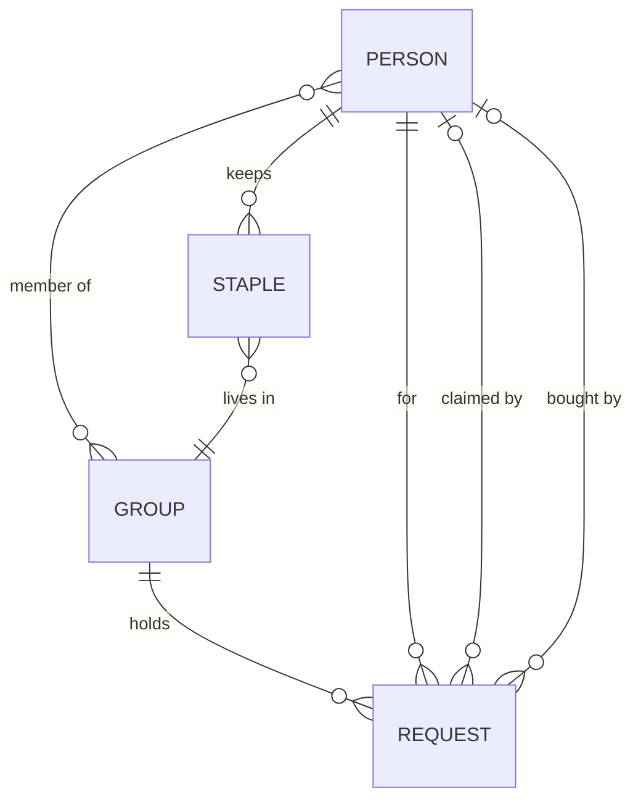

# Architecture

How loafkin is built, and the decisions a contributor should not undo
without a better reason than the one that put them here. Part 1 is the
overview. Part 2, from [Decisions](#decisions), is one entry per
decision, cited elsewhere by its D-ID. A feature's goals and success
criteria live in its issue.

## Context

loafkin is a shared request board for groups who shop for each other.
One Go binary serves server-rendered pages, a JSON API and live updates,
and runs the background work, over one PostgreSQL database (D-17, D-18,
D-23, D-29).

The parties around it:

- **Members** sign in without a password (D-10) and belong to any number
  of groups (D-03). In a group, anyone adds a request for anyone, claims
  it before shopping and marks it bought. Each member keeps a short list
  of staples in one group.
- **Admins** approve each join, and can remove members and requests.
  Nobody outside a group can see that it exists (D-04).
- **API clients** act for one member with that member's personal token
  (D-15).
- **Google and Apple** confirm who a member is over OpenID Connect
  (D-11).
- **An email sender in the EU** delivers sign-in codes and join requests
  (D-07, D-29).
- **The host** runs the container and PostgreSQL and keeps the backups
  (D-08, D-37).

The data, as members see it:

A person can be in many groups, and a group has many people. A request
lives in one group and is for one person; a member may claim it and then
buy it. Staples belong to a person and live in one group, the only group
that sees them. Every person is a signed-in member. A cleared request
stays in its group's history as text (D-09).

## Quality goals

In priority order:

1. **A group's data reaches only its members.** Authorization sits below
   the handlers, every route declares its permission, and every store
   method is scoped to the caller (D-04, D-21, D-22).
2. **Two buyers don't buy the same thing.** A change shows for everyone
   within a second or two (D-27), and a stale edit is refused rather
   than overwriting a newer one (D-26). Only a purchase marked offline
   can cross another, and the page then says so (D-28).
3. **It works in a store with poor signal.** The last list stays
   readable offline, and "bought" queues on the phone until it can be
   sent (D-28).
4. **Personal data stays in the EU and leaves when asked.** Deleting an
   account deletes its data, and deleted data is gone from backups
   within 30 days (D-07, D-08, D-09).
5. **One person can run it.** One binary and one database, with no queue
   server, cache server or separate worker (D-17, D-23, D-29).

## Codemap

Packages are sliced by layer under `internal/`, and each layer imports
only the layers below it (D-20). From the top:

- **The command.** `main` calls a `run` function, which starts `serve`
  or `migrate` (D-17). It is the only layer that wires the others
  together.
- **Entry points**, side by side, none importing another:
  - **page handlers** render pages and htmx fragments with
    `html/template` (D-18);
  - **API handlers** speak JSON, with errors as problem details and a
    stable code (D-15, D-33);
  - **live updates** listen on one database connection per instance and
    push fragments to open pages (D-27);
  - **workers** run the periodic tasks and send the outbox (D-29).
- **The domain** holds the rules every entry point calls (D-21).
- **The store** holds the SQL, and every method takes the caller (D-21,
  D-24).

Two leaves sit outside the stack, imported only by the command: the
**migrations**, embedded SQL (D-25), and the **browser assets**, the
service worker included (D-31).

## Runtime flows

### A claim shows on another phone

1. A member taps "I'm getting this". htmx posts the claim with the
   session cookie. Cross-origin protection checks where it came from
   (D-14), and the route's permission requires membership of the group
   (D-22).
2. The page handler calls the domain, which checks the rules. The store
   updates the request against the version the page last saw (D-26) and,
   in the same transaction, sends `NOTIFY` on the group's channel
   (D-27).
3. The transaction commits, and only then does PostgreSQL deliver the
   notification. Each instance renders the changed fragment for each of
   the group's open streams, as that stream's member after re-checking
   the session and membership, and pushes it over server-sent events.
4. A page that reconnects gets a fresh copy of the whole list, so it
   misses nothing.

### "Bought" in a store without signal

1. The service worker serves the last list it loaded, with a banner
   saying when it was updated (D-28).
2. The member taps "bought". The page saves the mark in IndexedDB with a
   unique key and shows it as waiting.
3. When loafkin is open with a connection again, the page sends the
   queue. The server applies each key once. If someone bought or removed
   the item meanwhile, it drops the mark, and the page says so.
4. Signing out deletes the cached pages and the queue.

### Signing in with an emailed code

1. A person enters their email address. The answer is the same whether
   or not the address has an account (D-33), and the request counts
   against the rate limits (D-43). loafkin creates a single-use code that
   expires within minutes and works only in this browser, and in the
   same transaction writes the email to the outbox (D-10, D-29).
2. A worker claims the outbox row with `SKIP LOCKED`, so no two
   instances claim it, and retries until the sender accepts it.
3. The person enters the code, or follows the link, in the same
   browser. The link carries its token in the URL fragment, and the page
   posts it (D-42). loafkin creates a session and sets a new token in a
   `__Host-` cookie (D-13).

## Invariants

The invariants live in one list, in
[`docs/security.md`](security.md#invariants), each with the decision
behind it. A way to break one is a vulnerability.

## Cross-cutting concerns

**Configuration and secrets.** Settings and secrets reach the binary
through its environment or files at run time, never from the repository
(D-39).

**Logging.** D-34 fixes what a log line may carry, and nothing else
reaches a log, error details included (D-33). Every log stays in the
EU for at most 45 days, and no URL carries a token (D-42).

**Errors.** A page shows a message a member can act on, and the JSON API
answers problem details with a stable code. No error carries anything
internal, and something the caller may not see looks exactly like
something that does not exist (D-33).

**Starting and stopping.** One package owns the order: stop accepting
requests, end the live streams, stop the workers, then close the
database pool (D-29). Migrations run before `serve` accepts requests
(D-25).

**Browser code.** It is hand-written, or vendored as single files pinned
by hash, and embedded in the binary. No page loads code from another
origin or runs inline script (D-31, D-32).

**Testing.** Data tests run against a real PostgreSQL, and browser flows
run through chromedp (D-35). There is no staging environment (D-36).

**Releases.** A release tag is a deploy, of an image named by its digest
and carrying build provenance (D-37, D-38).

## Decisions

One entry per decision. The index is the only place a decision's status
and what holds it are recorded; the entry holds the reasoning.

| ID | Decision | Status | Held by |
| --- | --- | --- | --- |
| D-01 | The product, its domain and its repository are all named loafkin | accepted | review |
| D-02 | One server-rendered website serves phones and computers; native apps wait | accepted | review |
| D-03 | A group is any set of people, not one household, and a person can be in many | accepted | review |
| D-04 | Groups are private and invite-only: no directory, no search, nothing shown before approval | accepted | review |
| D-05 | The source is public under the Apache License 2.0 and built in the open | accepted | review |
| D-06 | The interface is English only | accepted | review |
| D-07 | All personal data, photos, backups and email stay in the EU | accepted | review |
| D-08 | Backups are kept 30 days at most and restored by hand before launch and yearly | accepted | review |
| D-09 | Cleared requests stay in the group's history as text, without photos, as long as the group exists | accepted | review |
| D-10 | Sign-in has no passwords: Google and Apple through OpenID Connect, email codes, and passkeys | accepted | review |
| D-11 | Google and Apple sign-in run inside loafkin on go-oidc and x/oauth2 | accepted | review |
| D-12 | Passkeys use go-webauthn | accepted | review |
| D-13 | Sessions live server-side in PostgreSQL behind a `__Host-` cookie: 30 days, or 7 days unused | accepted | review |
| D-14 | Every state-changing route passes `http.CrossOriginProtection`, and no GET outside sign-in changes state | accepted | review |
| D-15 | The JSON API exists from the start and uses personal tokens: prefixed, hashed, expiring within 365 days | accepted | review |
| D-16 | Go, kept on the newest release | accepted | review |
| D-17 | One module, `loafkin.com`, builds one binary with `serve`, `migrate` and maintenance subcommands | accepted | review |
| D-18 | The server renders HTML with `html/template`, and htmx adds interactivity | accepted | review |
| D-19 | Routing uses `http.ServeMux`, and middleware is a plain `func(http.Handler) http.Handler` | accepted | review |
| D-20 | Packages are sliced by layer under `internal/`, and the import direction is gated | accepted | review |
| D-21 | Page and API handlers call one domain layer; one store holds all SQL, every method scoped to the caller | accepted | review |
| D-22 | Every route declares its permission, and a route without one fails a test | accepted | review |
| D-23 | PostgreSQL holds all data, photos included | accepted | review |
| D-24 | SQL is written by hand on pgx, with no ORM and no code generator | accepted | review |
| D-25 | goose migrations are embedded and run at startup under a lock; each keeps the previous release working, and production fixes forward | accepted | review |
| D-26 | Edits are guarded by a version column | accepted | review |
| D-27 | Live updates are SSE fragments, announced by `NOTIFY` inside the committing transaction | accepted | review |
| D-28 | An offline "bought" waits in IndexedDB under a unique key that the server applies once | accepted | review |
| D-29 | Background work runs in the app process and stops in one shutdown order; email goes through an outbox | accepted | review |
| D-30 | Photos are resized in the browser and re-encoded by the server, which drops all metadata | accepted | review |
| D-31 | Browser code is hand-written, or vendored as single files pinned by hash, and embedded with `go:embed`; no Node | accepted | review |
| D-32 | Every response carries a strict Content Security Policy with no inline script | accepted | review |
| D-33 | Errors reveal nothing internal or hidden: problem details with a stable code, generic server errors, and 404 for what the caller may not see | accepted | review |
| D-34 | Logs name the route pattern and a keyed hash of the user, never a path, a cookie or a payload | accepted | review |
| D-35 | Data tests run against a real PostgreSQL, and browser tests run in `go test` through chromedp | accepted | review |
| D-36 | There is no staging: browser tests run in CI against the built image, and a smoke check follows each deploy | accepted | review |
| D-37 | A deploy names an image digest with GitHub build provenance; no cosign signature and no SBOM | accepted | review |
| D-38 | A release tag is a deploy, and the public JSON API is the versioning contract | accepted | review |
| D-39 | Nothing internal enters the repository: no secret, no production data, no personal detail, no infrastructure identifier | accepted | leaks, leaks-staged, review |
| D-40 | No agent commits, pushes, tags or merges; the owner merges every pull request | accepted | review |
| D-41 | Every `http.Server` sets its timeouts, and a live stream manages its own write deadline | accepted | review |
| D-42 | Every log, the host's and the database's included, stays in the EU for at most 45 days, and no URL carries a token | accepted | review |
| D-43 | Sign-in rate limits live in PostgreSQL and count requests, not sends | accepted | review |
| D-44 | A Google or Apple identity is keyed on its issuer and subject, never an email address, and is linked only from a signed-in session after a fresh sign-in | accepted | review |
| D-45 | Remove and clear wait for the Undo bar to close, so undoing them sends nothing | accepted | review |

### D-01 The product, its domain and its repository are all named loafkin

One name covers the product, the domain loafkin.com and the GitHub
repository mmedum/loafkin, so there is one thing to search for. It joins
a loaf of bread, the most ordinary item on a shopping list, with kin,
the people you shop for. It reads the same in English and Danish.

Rejected: kinlist, because an app called KinList already does the same
job. dibsboard, one letter from an existing restaurant app, with a word
many Danes don't know. kinfetch, too close to existing errand apps.
storerun and runlist, whose .com domains are taken.
Cost: "loaf" also means to idle, so the name hints rather than
describes. No trademark search backs it.

### D-02 One server-rendered website serves phones and computers; native apps wait

loafkin is one website, rendered on the server, that works the same on a
phone and a computer. A web page reaches every phone without an install,
so a group is never split by the one member who can't or won't install
an app. Caregiving coordination apps such as
[ianacare](https://apps.apple.com/us/app/ianacare-caregiving-support/id1441737626)
run on phone or computer for the same reason. Native apps can follow if
the website proves itself, on the JSON API (D-15).

Rejected: native apps first, which means two codebases and an install
before anyone can join. A single-page app, which adds a framework
runtime, client-side routing and state, and a Node build (D-31).
Cost: Safari deletes a site's script-writable storage, the offline list
included, after seven days of Safari use with no interaction on the
site; a site added to the Home Screen keeps its own count
([WebKit](https://webkit.org/blog/10218/full-third-party-cookie-blocking-and-more/)).
On an iPhone, web push is offered to a site added to the Home Screen
([WebKit](https://webkit.org/blog/13878/web-push-for-web-apps-on-ios-and-ipados/)).
iPhone checks are by hand (D-35).

### D-03 A group is any set of people, not one household, and a person can be in many

A group is any set of people who shop for each other: a family spread
over several homes, roommates, neighbors, or someone and the parent they
shop for. Anyone can create one, a person can be in as many as they
like, and one shopping list covers them all. Household apps model one
home, and families who share food across homes ask for exactly this: a
[Grocy issue](https://github.com/grocy/grocy/issues/644) asks to see
"what's in which house", and a project member judged a split into homes
technically unlikely.

Rejected: one household per account, as most list apps have it, which
gives a person who shops for two homes two accounts.
Cost: a group is not a household, so the GDPR's household exemption
does not cover every use. A club or a small care business can use
loafkin for the people it serves.

### D-04 Groups are private and invite-only: no directory, no search, nothing shown before approval

A group is private. There is no directory and no search, and only
members can see that a group exists. An invite link is a long random
token that expires after 7 days, and joining always needs an admin's
approval. The invite page
shows only the group's name and who invited you, and a link preview in
a chat app shows a generic invitation.

Approval keeps each group a circle its members chose. The GDPR asks that
by default personal data are "not made accessible without the
individual's intervention to an indefinite number of natural persons"
([Art. 25(2)](https://eur-lex.europa.eu/eli/reg/2016/679/oj)). Under the
Digital Services Act, a hosting service that disseminates information
to the public, meaning a potentially unlimited number of people, is an
online platform
([Art. 3(i) and (k)](https://eur-lex.europa.eu/eli/reg/2022/2065/oj)).

Rejected: one hard-to-guess link per group with no approval, and
approval an admin can switch off. Either lets a forwarded link admit
anyone.
Cost: joining needs an account and an admin's approval, and admins get
an email for each request.

### D-05 The source is public under the Apache License 2.0 and built in the open

The repository is public from its first commit, under the
[Apache License 2.0](https://www.apache.org/licenses/LICENSE-2.0) with a
NOTICE file. Anyone can read how loafkin treats the data people trust it
with, and reuse the code. The license grants patent rights beside
copyright, and its section 5 puts each contribution under the same
license unless its author says otherwise.

Rejected: a closed repository, which asks people to trust code they
cannot read.
Cost: every commit is published for good, so a leak cannot be taken
back (D-39).

### D-06 The interface is English only

loafkin is an English-language product. Every page, email and the
privacy policy is in English, so each text has one version to write,
test and keep correct.

Rejected: a Danish interface, alone or beside English.
Cost: the GDPR asks that privacy information be intelligible to the
people it is for
([Art. 12(1)](https://eur-lex.europa.eu/eli/reg/2016/679/oj)). A member
who reads English poorly, an older relative for one, gets pages and a
policy they may not follow.

### D-07 All personal data, photos, backups and email stay in the EU

Personal data, photos, backups and email are stored and processed in the
EU, by loafkin and by every service it uses: the host, the database, the
backups and the email sender. The promise covers what loafkin controls,
so a member's own mailbox is outside it. The GDPR does not require this;
it is loafkin's promise. It keeps a group's data under one legal regime,
with no transfer mechanism to depend on.

Rejected: storage outside the EU under an adequacy decision such as the
EU–US Data Privacy Framework, or another transfer safeguard
([GDPR Chapter V](https://eur-lex.europa.eu/eli/reg/2016/679/oj)), which
would make the promise depend on that framework surviving.
Cost: fewer vendors to choose from, the email sender above all. Mail to
an Apple private relay address passes through Apple's relay
([Apple](https://developer.apple.com/documentation/signinwithapple/communicating-using-the-private-email-relay-service)),
outside loafkin's control.

### D-08 Backups are kept 30 days at most and restored by hand before launch and yearly

The host keeps backups for 30 days or less, so data deleted from loafkin
is gone from every backup within 30 days, and the privacy policy says
so. A drill restores a backup into a scratch database and checks it, by
hand, before launch and then once a year.

A restore never brings back a deleted account. The EDPB expects
organizations to "keep track of erasure requests and comply with them
on restored systems"
([CEF report on the right to erasure](https://www.edpb.europa.eu/system/files/2026-02/edpb_cef-report_2025_right-to-erasure_en.pdf)).
Each deletion of an account or a group writes a log line carrying a
keyed hash of what was deleted (D-34). After a restore, and before
loafkin serves requests again, a maintenance subcommand deletes again
everything those lines name since the restored backup was taken (D-17).
A deletion request that arrives by email goes through the same kind of
subcommand and the store, so it writes the same line.

The GDPR asks for the ability to restore personal data in a timely
manner after an incident, and for regular testing of the measures that
protect it
([Art. 32(1)(c) and (d)](https://eur-lex.europa.eu/eli/reg/2016/679/oj)).
A backup nobody has restored is not yet a backup.

Rejected: retention over 30 days, which several managed PostgreSQL plans
default to and which breaks the promise. An automated monthly drill with
a deletion canary, which costs more than its risk at loafkin's size. A
list of deleted accounts in the database, which a restore rolls back
with everything else. A separate store for that list, one more component
to run.
Cost: the host must keep logs longer than the oldest backup plus the
time a restore takes. A log line that is lost lets one deleted account
come back after a restore. Between drills, a broken backup can go
unnoticed for a year.

### D-09 Cleared requests stay in the group's history as text, without photos, as long as the group exists

When a request is cleared, its text stays in the group's history: the
item, the note, whether it was marked "exactly this, no substitutes",
whom it was for, who claimed and bought it, and when. The photo is
deleted with the request. History lasts as long as the group, and
statistics are built from it. It answers "did anyone buy this last
week?" without collecting anything more.

Deleting an account deletes the history entries it bought or was for,
and removes its name from the rest. A member who leaves a group shows in
its history as "Former member".

Rejected: a rolling window of 12 to 24 months; purging history entries
automatically after a time; deleting an item the moment it is checked
off.
Cost: years of purchases can reveal health and habits, and storage
limitation
([Art. 5(1)(e)](https://eur-lex.europa.eu/eli/reg/2016/679/oj)) has to be
argued for the group's whole life. "Former member" is pseudonymization,
not anonymization. Statistics are a purpose the privacy policy has to
declare from the start.

### D-10 Sign-in has no passwords: Google and Apple through OpenID Connect, email codes, and passkeys

Nobody has a password. A member signs in with Google or Apple over
OpenID Connect, with a single-use 6-digit code or link sent by email,
or with a passkey added after the first sign-in. Email codes expire
within minutes, are rate-limited, and work only in the browser that
asked for them. A member with a passkey can turn email sign-in off.
Changing how you sign in, exporting or deleting asks for a passkey or an
email code when the last sign-in is over 10 minutes old.

No password means none to reuse, phish or leak, and no reset flow to
attack.
[OWASP's passkey guidance](https://cheatsheetseries.owasp.org/cheatsheets/Passkey_Security_Cheat_Sheet.html)
notes that a passkey account is only as secure as its weakest recovery
route, so email sign-in is something a member can close.

Rejected: passwords; email only as a recovery step behind a second
factor, which locks out members with no Google, Apple or passkey.
Cost: email is a single factor.
[NIST SP 800-63B-4](https://pages.nist.gov/800-63-4/sp800-63b.html) does
not accept it for out-of-band authentication, and
[ASVS 5.0](https://github.com/OWASP/ASVS/blob/v5.0.0/5.0/en/0x15-V6-Authentication.md)
rules it out as an authentication factor at its highest level
(requirement 6.3.6). Mail scanners open links, so an emailed link opens
a page that confirms with a POST. Apple relays mail to a private address
only once loafkin's sending domain is registered with Apple
([Apple](https://developer.apple.com/documentation/signinwithapple/communicating-using-the-private-email-relay-service)).

### D-11 Google and Apple sign-in run inside loafkin on go-oidc and x/oauth2

Google and Apple sign-in are loafkin's own code on
[go-oidc](https://pkg.go.dev/github.com/coreos/go-oidc/v3/oidc) and
`golang.org/x/oauth2`. go-oidc verifies an ID token's signature, issuer
and audience, and leaves the nonce to the caller, so loafkin checks it.

Apple needs more. Its callback is a cross-site `form_post`. It sends the
member's name only at the first sign-in
([Apple](https://developer.apple.com/documentation/signinwithapplerestapi/request-an-authorization-to-the-sign-in-with-apple-server)).
Its client secret is a JWT signed with the `.p8` key and valid for at
most six months
([Apple](https://developer.apple.com/documentation/accountorganizationaldatasharing/creating-a-client-secret)),
so loafkin mints one per request rather than rotating it by hand.

Rejected: a hosted identity provider, which adds a sub-processor, binds
passkeys to the vendor's domain and takes every sign-in method down in
one outage. A self-hosted one such as Keycloak or Zitadel, one more
service to patch. goth, which skips the nonce check. zitadel/oidc, which
has no Apple support.
Cost: loafkin owns every Apple quirk in code. go-oidc is not
OpenID-certified. Apple supports neither PKCE nor the `iss` parameter,
so the state, the nonce and one redirect URI per provider carry the
protection.

### D-12 Passkeys use go-webauthn

Passkeys use [go-webauthn](https://pkg.go.dev/github.com/go-webauthn/webauthn/webauthn),
which Miniflux, Gitea and Pocket ID import too. A member re-authenticates
before adding a passkey, as
[OWASP's passkey guidance](https://cheatsheetseries.owasp.org/cheatsheets/Passkey_Security_Cheat_Sheet.html)
asks, and loafkin counts a sign-in within the last 10 minutes as recent
enough (D-10).

Rejected: passkeys held by a hosted identity provider, which binds them
to the vendor's domain, so leaving means every member enrolls again.
Cost: a passkey is bound to loafkin.com, so a domain change means
enrolling again. Synced passkeys often report a signature count of 0, so
a count anomaly is logged, never blocked. loafkin owns the correctness
of each ceremony.

### D-13 Sessions live server-side in PostgreSQL behind a `__Host-` cookie: 30 days, or 7 days unused

A session is a row in PostgreSQL. The browser holds a random token in a
`__Host-` cookie that is `Secure`, `HttpOnly` and `SameSite=Lax`, and
only the token's hash is stored. Each sign-in and each re-check issues a
fresh token. A session lasts 30 days, or ends after 7 days unused.

Members can list their sessions and sign out everywhere, which also
revokes their API tokens (D-15). Apple's cross-site callback carries its
pending sign-in in a separate short-lived cookie, `SameSite=None` so
that Apple's cross-site POST carries it.

A server-side session can be revoked at once.
[NIST SP 800-63B-4](https://pages.nist.gov/800-63-4/sp800-63b.html)
recommends the `__Host-` prefix, and an overall reauthentication timeout
of no more than 30 days at AAL1, its lowest assurance level.

Rejected: JWT or other self-contained sessions, which cannot be revoked
without state and let a stolen key forge any session. A cookie-only
store such as gorilla/sessions', which cannot sign out everywhere.
`SameSite=Strict`, which makes links from email and chat arrive signed
out.
Cost: a store lookup on every request, and throttled writes for the idle
timer. A persistent 30-day cookie and a 7-day idle timeout sit well
above NIST's values for higher assurance. ASVS 5.0 asks for deviations
from NIST's reauthentication values to be justified, and this entry is
that justification: a phone at the shelf that has signed itself out is
the failure that matters here.

### D-14 Every state-changing route passes `http.CrossOriginProtection`, and no GET outside sign-in changes state

Every route runs behind Go's
[`http.CrossOriginProtection`](https://pkg.go.dev/net/http#CrossOriginProtection),
which rejects a cross-origin state-changing request from the browser's
`Sec-Fetch-Site` and `Origin` headers, with no tokens. It lets through a
request that carries neither header, so loafkin's own check rejects such
a request when the session cookie signs it in, the fail-safe option in
[OWASP's CSRF guidance](https://cheatsheetseries.owasp.org/cheatsheets/Cross-Site_Request_Forgery_Prevention_Cheat_Sheet.html).
A request with an API token passes, since a browser never sends one on
its own. Gitea removed its CSRF cookie in favor of Go's
`CrossOriginProtection`
([go-gitea/gitea#36183](https://github.com/go-gitea/gitea/pull/36183)).

Only Apple's callback is exempt, and its `state` check protects it. No
GET changes a member's data, which the protection assumes, except the
sign-in start link and Google's callback. The `state` and nonce of each
sign-in attempt protect those. Bookkeeping, such as a session's last
use, can change on any request.

Rejected: synchronizer tokens, state in every form for no gain on the
browsers loafkin supports. `SameSite` alone, which is not a cross-origin
defense. Trusting Apple's origin, which would open every route to it.
Cost: it needs HTTPS with HSTS. A browser that sends neither header
cannot change anything. A proxy that rewrites `Host` causes false
rejections. NIST still asks for a session identifier in every POST.

### D-15 The JSON API exists from the start and uses personal tokens: prefixed, hashed, expiring within 365 days

The JSON API is built beside the pages from the start, on the same
domain layer (D-21). A member authenticates to it with a personal token
created in settings. A token carries a loafkin prefix, so a leaked one
can be detected; it is stored as a hash and shown once; it must expire
within 365 days; it records when it was last used; and it can be
revoked. OAuth with PKCE comes beside tokens when native apps do (D-02).

Creating a token needs a fresh sign-in (D-10), and an email tells the
member a token was made. A token cannot create tokens, export data,
delete the account or change how its owner signs in. Signing out
everywhere revokes every token too (D-13).

[GitLab's personal access tokens](https://docs.gitlab.com/user/profile/personal_access_tokens/)
have the same shape, with an expiry required by default.
[OWASP](https://cheatsheetseries.owasp.org/cheatsheets/Secrets_Management_Cheat_Sheet.html)
notes that a consistent secret format is easier to detect. A token of
160 random bits gains nothing from a slow hash, so a standard hash is
enough.

Rejected: an OAuth server of loafkin's own from the start. Google or
Apple tokens as API credentials, which they are not, and which email and
passkey members lack. Tokens in a query string. Tokens that never
expire.
Cost: a token is one more way into an account, beside passkeys and
email. Third-party clients get no sign-in flow of their own.

### D-16 Go, kept on the newest release

loafkin builds with the newest Go release and moves to each release as
it ships. Go supports a major release "until there are two newer major
releases" ([release policy](https://go.dev/doc/devel/release#policy)),
and its
[security guidance](https://go.dev/doc/security/best-practices#keep-your-go-version-and-dependencies-up-to-date)
says to keep to the latest minor version for security fixes.

Rejected: the older of the two supported releases, which buys nothing
for a server built and deployed from source.
Cost: a toolchain bump every six months, with `go.mod` and CI moving
together.

### D-17 One module, `loafkin.com`, builds one binary with `serve`, `migrate` and maintenance subcommands

loafkin is one Go module at the repository root, with the path
`loafkin.com`. It builds one binary whose `main` only calls a `run`
function that tests can call too. `serve` runs the website and `migrate`
runs migrations on demand (D-25). Maintenance subcommands delete an
account on an emailed request and re-apply logged deletions after a
restore, always through the store (D-08). The site at loafkin.com serves the
`go-import` meta tag that points the path to the repository.
[Go's module layout guide](https://go.dev/doc/modules/layout) calls a
`cmd` directory for commands a common convention.

Rejected: a path on the code host, which changes when the repository
moves; several binaries, or a separate worker process, a second deploy
unit for no gain at this size.
Cost: `go install` and pkg.go.dev resolve the module only while
loafkin.com serves the meta tag.

### D-18 The server renders HTML with `html/template`, and htmx adds interactivity

The server renders every page, htmx fragment and live update with Go's
[`html/template`](https://pkg.go.dev/html/template), and htmx swaps the
fragments in place. Escaping is contextual, and the package "assumes
that template authors are trusted, while Execute's data parameter is
not", so what a member writes cannot become markup. Miniflux renders on
the server for the same reason: it is simple, and fast enough for this
kind of app.

Rejected: templ, which adds a code-generation step and a pre-1.0
dependency; Datastar, whose signals add a second state model; a
single-page app (D-02).
Cost: a template error appears at run time, so every template and
fragment has a render test (D-35). htmx is a dependency loafkin vendors
and follows (D-31).

### D-19 Routing uses `http.ServeMux`, and middleware is a plain `func(http.Handler) http.Handler`

Routing uses `net/http`'s `ServeMux`, with method and wildcard patterns,
where the most specific pattern wins
([Go blog](https://go.dev/blog/routing-enhancements)). Middleware is a
plain `func(http.Handler) http.Handler`. Miniflux and PocketBase both
route with the standard library, with no router dependency.

Rejected: chi, which earns its place only with subrouters, custom 404
and 405 handling or regular-expression wildcards; gorilla/mux; Echo.
Cost: `ServeMux` cannot list its routes, so the permission check keeps a
registry of its own (D-22). A custom 404 beside the automatic 405 takes
care. Every `ResponseWriter` wrapper must implement `Unwrap`, or
flushing a live stream fails (D-27).

### D-20 Packages are sliced by layer under `internal/`, and the import direction is gated

Packages are sliced by layer under `internal/`. From the top: the
command; the entry points, which are the page handlers, the API
handlers, the live updates and the workers; the domain; and the store.
The migrations and the browser assets are leaves only the command
imports. A layer imports only layers below it, entry points never import
each other, and a gate fails on an import the other way.
[Gitea's backend guidelines](https://github.com/go-gitea/gitea/blob/eb3bc196ec00efd184b663dead91ca89ca2ee0c3/docs/guidelines-backend.md)
state the same one-way rule. Go's
[`internal` directory](https://pkg.go.dev/cmd/go#hdr-Internal_packages),
at the module root, keeps every package private to the module.

Rejected: slicing by feature, as Pocket ID's backend is organized.
Leaving the direction to review, where it drifts.
Cost: one feature's change touches several packages. Names have to avoid
stutter such as `handler.UserHandler`. Moving to feature slices later is
one large move that is hard to review.

### D-21 Page and API handlers call one domain layer; one store holds all SQL, every method scoped to the caller

Page handlers and JSON API handlers are separate packages with separate
routes, and both call one domain package that holds the rules. One store
package holds every statement that reads or writes members' data; the
migrations (D-25) and the live-update listener (D-27) are the only other
code that talks to the database. Every store method takes the caller,
a member or the system identity background work runs as, and returns
only what that caller may see, as
[Miniflux's storage](https://github.com/miniflux/v2/blob/f654f7c7675e5c4cbd6ef5bb5858aa8d9bdf2af1/internal/storage/category.go#L48)
takes the user id. Public ids are random, never row ids, so an id tells
nothing about other rows. The JSON API stays stable while pages change freely,
as
[htmx argues](https://htmx.org/essays/why-tend-not-to-use-content-negotiation/).

Rejected: one handler that picks HTML or JSON by the `Accept` header.
Pages as a JavaScript client of the JSON API. PostgreSQL row-level
security as a second layer, which costs a transaction per request. A
store interface before a second implementation exists.
Cost: a store method that forgets its group condition leaks data instead
of returning nothing. The system identity can see across groups, so
only background work may use it.

### D-22 Every route declares its permission, and a route without one fails a test

Every route is registered with the permission it needs, or as public. A
test builds the full route table and fails on a route that declares
neither, so a forgotten check is a red build, not a leak. Pocket ID's
[route coverage test](https://github.com/pocket-id/pocket-id/blob/87ddbf712a099230659d476cad9559bea0c2e1fc/backend/internal/bootstrap/route_coverage_test.go#L26)
fails the same way on an API route with neither a scope nor public
access. A second generated test calls every route that takes an id as a
member of another group, with a real id from that group, and expects
the same 404 a random id gets (D-33).
[OWASP's authorization guidance](https://cheatsheetseries.owasp.org/cheatsheets/Authorization_Cheat_Sheet.html)
asks to deny by default and to centralize the handling of failed
checks.

Rejected: permission middleware written once per handler tree, which
drifted between Gitea's web and API trees.
Cost: `ServeMux` cannot list its patterns, so loafkin keeps its own
route registry beside it (D-19).

### D-23 PostgreSQL holds all data, photos included

PostgreSQL holds all of loafkin's data. A photo is stored as `bytea`
beside its request, deleted in the same transaction that clears the
request, and served only through loafkin after the group check (D-30).
[pgx](https://github.com/jackc/pgx) exposes `LISTEN` and `NOTIFY`, which
live updates need (D-27).

Rejected: SQLite with Litestream, a single writer that can lose about a
second of writes in a crash; object storage for photos, which needs
versioning off, an orphan sweeper and signed URLs to delete and serve
photos safely.
Cost: backups carry the photos, so they grow with them and fall under
the same 30 days (D-08). Serving photos uses loafkin's own bandwidth.

### D-24 SQL is written by hand on pgx, with no ORM and no code generator

The store's SQL is written by hand and runs on pgx, PostgreSQL's native
driver. Each query is visible where it runs, with the caller's scope in
its `WHERE` clause (D-21). Miniflux
[avoids ORMs](https://github.com/miniflux/website/blob/6108e3321c16b2fc189c0051c5c6b94d8841f02a/content/opinionated.md)
because they hide what the database can do.

Rejected: an ORM, whose generated queries hide that scope. sqlc, which
adds a generate-and-diff step to CI. Query builders. `database/sql`
alone, which has no `LISTEN`.
Cost: no generated, typed queries. Queries name their columns, since
`SELECT *` into a struct breaks when a column is added. goose reaches
the pool through pgx's `database/sql` adapter (D-25).

### D-25 goose migrations are embedded and run at startup under a lock; each keeps the previous release working, and production fixes forward

Migrations are SQL files run by goose and embedded in the binary. They
run at startup under goose's PostgreSQL session lock, so one instance
migrates while the others wait, and `loafkin migrate` runs them on
demand. goose locks only when its provider is given a session locker
through `WithSessionLocker`
([goose](https://pkg.go.dev/github.com/pressly/goose/v3)).

Each migration keeps the previous release working, so rolling back the
code is safe. Each sets a `lock_timeout`, so a schema change stuck
behind a long query fails rather than blocking every query on its
table. Every file has a Down section for resetting a development
database. Production never runs one and fixes forward with a new
migration.

Rejected: a separate migration step before each deploy, which needs a
host feature to run it. golang-migrate, which leaves a failed migration
marked dirty until someone forces the version by hand
([golang-migrate](https://github.com/golang-migrate/migrate/blob/master/GETTING_STARTED.md#forcing-your-database-version)).
Down migrations in production.
Cost: a failing migration crash-loops the server, and a slow one races
the health checks. The app's database user holds the right to change
the schema. The session lock fails behind a transaction-pooling proxy
such as PgBouncer.

### D-26 Edits are guarded by a version column

Each editable row carries a version number. An edit names the version it
was made from, the store updates the row only while the version still
matches, and a mismatch is refused and shown as a conflict, never
written over the newer change. Two members editing the same request at
once is the case it covers.

Rejected: an ETag checked with `If-Match`, which suits the JSON API but
not htmx forms.
Cost: every edit form and API write carries the version, and a conflict
needs a message the member can act on.

### D-27 Live updates are SSE fragments, announced by `NOTIFY` inside the committing transaction

A change sends PostgreSQL `NOTIFY` inside the transaction that makes it.
Notifications "are not delivered until and unless the transaction is
committed" ([PostgreSQL](https://www.postgresql.org/docs/current/sql-notify.html)),
so a rollback announces nothing. Each instance listens on one dedicated
connection and pushes re-rendered fragments to its open pages as
server-sent events, through htmx's SSE extension. A change shows for
everyone within a second or two. A reconnecting page gets a fresh copy
of the whole list, so nothing it missed is lost.

Each push is rendered through the store as the stream's member, after
re-checking the session and the membership. A stream therefore sends
only what its member may see at that moment. Removing a member or
revoking a session sends a `NOTIFY` that closes the matching streams,
and every stream has a maximum lifetime.

The listener uses a direct connection, never a pooled one. When it
reconnects, every open stream gets the whole list again, since
notifications sent while it was down are lost. Each stream carries a
ping about every 25 seconds, so proxies keep it open.

Rejected: WebSockets, unneeded since every action is a POST, and harder
to proxy. An in-memory broker, which reaches only its own instance.
Replaying deltas from an event log, which htmx gives no help
deduplicating. Publishing before the commit, which a rollback cannot
take back.
Cost: by default a payload must stay under 8000 bytes, so a
notification carries only ids, and each instance reads the change back.
A browser allows six HTTP/1.1 connections per site, so the site needs
HTTP/2.

### D-28 An offline "bought" waits in IndexedDB under a unique key that the server applies once

A service worker keeps the last loaded list and loafkin's assets. A
"bought" made offline is stored in IndexedDB under a unique key and
shown as waiting. The page sends the queue when it opens or the
connection returns, and the server applies each key once. It applies a
mark while the item is open, or claimed by the member who sent it,
whatever the item's version (D-26). Otherwise it drops the mark, and
the page says so.

The cache and the queue belong to one account. A queued mark carries
its account, its key is unique per member, and the server refuses a
mark sent under another account. Signing out, any 401 and a change of
account delete the cached pages and the queue, and signing out also
sends `Clear-Site-Data`. Pages that show a token, an export or settings
are sent with `Cache-Control: no-store`.

Safari on iPhone has no
[Background Sync](https://caniuse.com/background-sync), so the queue
cannot depend on it. The key follows the
[Idempotency-Key draft](https://datatracker.ietf.org/doc/draft-ietf-httpapi-idempotency-key-header/):
a key is never reused for a request with a different payload.

Rejected: Background Sync as the base; retrying from page memory, which
dies with the tab.
Cost: on an iPhone, a queued mark is sent only the next time loafkin is
open. The server keeps keys, and the endpoint stays compatible, for as
long as a queued mark can wait.

### D-29 Background work runs in the app process and stops in one shutdown order; email goes through an outbox

Background work runs in the app process. Tickers clear bought items
after 7 days, and remove expired sessions, invites and tokens.

Email goes through an outbox table: a row is saved in the same
transaction as the change that causes it, and a worker sends it with
retries. The worker claims rows with `SKIP LOCKED`, so two instances
never claim the same row. Sending is at least once: a worker that sends
and then fails before it commits sends that email again. The row's id
goes to the sender as an idempotency key where the sender takes one. A
row is deleted once sent, once its code expires, or with its account.

One package owns the shutdown order: stop accepting requests, end the
live streams, stop the workers, then close the database pool.
[`http.Server.Shutdown`](https://pkg.go.dev/net/http#Server.Shutdown)
waits for connections to go idle and does not close hijacked ones, so
streams need their own end and the shutdown a deadline.

Rejected: River, which is pre-1.0 and whose periodic schedule resets
across restarts; a separate worker process, a second deploy unit.
Cost: loafkin implements retries, backoff and uniqueness itself. With
several instances, each periodic task needs a lock so it runs once.

### D-30 Photos are resized in the browser and re-encoded by the server, which drops all metadata

The page resizes a photo and converts it to JPEG in a canvas, which also
handles HEIC and rotation. The server checks the dimensions with
[`image.DecodeConfig`](https://pkg.go.dev/image#DecodeConfig) before a
full decode, then decodes with
[`image/jpeg`](https://pkg.go.dev/image/jpeg) under size limits. The
decoder skips EXIF data
([reader.go](https://go.dev/src/image/jpeg/reader.go)), so the server
applies the orientation tag itself, and a photo sent through the JSON
API comes out upright too. It then re-encodes, and the encoder writes
no EXIF ([writer.go](https://go.dev/src/image/jpeg/writer.go)), so
location, camera and time are gone whatever the client sent. Only the
re-encoded bytes are stored.

Rejected: trusting the browser's conversion alone, which a client can
skip; decoding HEIC on the server, which needs WASM or cgo; keeping the
original; refusing photos through the JSON API.
Cost: loafkin reads the orientation tag and applies its eight rotations
and flips in its own code. iPhone's HEIC handling changes between
releases and needs re-testing on a device. Uploading a photo needs a
connection.

### D-31 Browser code is hand-written, or vendored as single files pinned by hash, and embedded with `go:embed`; no Node

Browser code is product code that cannot be Go: htmx and its SSE
extension, loafkin's own scripts, the service worker and the CSS. It
lives in one directory and is embedded in the binary with `go:embed`.
Third-party libraries are vendored as single files pinned by hash.
htmx's own docs say "you may want to consider not using CDNs in
production" ([htmx](https://htmx.org/docs/#installing)). There is no
Node toolchain, as in Miniflux and PocketBase.

Rejected: a Node build; a JavaScript linter from another toolchain;
playwright-go, which bundles Node.
Cost: go-licenses cannot see vendored files, so their licenses are
listed and checked separately. Updating a vendored file is by hand, and
nothing lints the JavaScript.

### D-32 Every response carries a strict Content Security Policy with no inline script

Every response carries a Content Security Policy that loads scripts and
styles only from loafkin's own origin, with no inline script or style,
no eval, no plugins, no framing and no `<base>`. htmx runs under it with
`allowEval` off, so no `hx-on` attribute, trigger filter or `js:` value
is used, and its indicator styles live in the stylesheet
([htmx security](https://htmx.org/docs/#security)). Sign-in with Google
or Apple starts from a link, so forms post only to loafkin.

Rejected: a nonce-based policy
([web.dev](https://web.dev/articles/strict-csp)), which still runs inline
script that carries the nonce, and needs a nonce passed into every
template; `unsafe-eval` for htmx's expression features.
Cost: a policy cannot stop an injected `hx-post` attribute from firing,
so escaping stays the real control (D-18). Every behavior lives in an
embedded file (D-31).

### D-33 Errors reveal nothing internal or hidden: problem details with a stable code, generic server errors, and 404 for what the caller may not see

An error from the JSON API is a problem details document
([RFC 9457](https://www.rfc-editor.org/rfc/rfc9457)) with `type`,
`title`, `status` and `detail`, plus a stable `code` from a closed list.
A client branches on the code, and the wording can change. A page shows
a message the member can act on.

No error tells the caller anything they should not learn, whether in a
page, an API response or an email:

- An unexpected error answers 500 with a generic message and a request
  id. The details go only to the log, as loafkin's own code, the
  PostgreSQL error code or the upstream status, never as raw error
  text, which can carry personal data (D-34). That follows
  [OWASP's error handling guidance](https://cheatsheetseries.owasp.org/cheatsheets/Error_Handling_Cheat_Sheet.html).
- No response carries a stack trace, SQL, an internal id, a file path,
  or the error text of Google, Apple, the database or the email sender.
  Each maps to one of loafkin's own codes.
- A group, request or photo the caller may not see answers 404, exactly
  like one that does not exist, so no response confirms a private group
  (D-04).
- Sign-in never confirms that an account exists. Asking for a code gets
  the same answer, the same writes and the same cookie whether or not
  the address can sign in, and rate limits count requests rather than
  sends (D-43), as
  [OWASP's authentication guidance](https://cheatsheetseries.owasp.org/cheatsheets/Authentication_Cheat_Sheet.html)
  advises. The email goes through the outbox (D-29), so the response
  time gives nothing away either.

Rejected: the message text as the contract, which breaks a client
whenever the wording changes; 403 for something the caller may not see,
which confirms it exists; an error body of loafkin's own design, which
no client library knows.
Cost: the codes are part of the versioning contract (D-38), so removing
or renaming one is breaking. A member who mistypes an email address
waits for a code that never comes. Tracing a reported error needs its
request id.

### D-34 Logs name the route pattern and a keyed hash of the user, never a path, a cookie or a payload

A log line records the route pattern, the outcome, the duration, a
request id and a keyed hash of the member, and an error as codes only
(D-33). It never records the request path, the query string, a cookie,
an `Authorization` header or a body. The route pattern
([`Request.Pattern`](https://pkg.go.dev/net/http#Request)) is the
"where", since it names the route without the ids in its path, and no
URL carries a token (D-42). The keyed hash lets an operator follow one
member's requests without naming them. The key has a version, carried
in each line, so rotating it keeps older lines usable (D-08).
[OWASP's logging guidance](https://cheatsheetseries.owasp.org/cheatsheets/Logging_Cheat_Sheet.html)
asks for the when, where, who and what of each event, and suggests
hashing session identifiers where tracking needs them.

Rejected: logging the path. OpenTelemetry's HTTP defaults, which record
the path on every server span. A hosted error tracker whose account data
leaves the EU (D-07).
Cost: a keyed hash is still personal data. A canary test must drive
every route, error paths included, to prove no forbidden value reaches a
log.

### D-35 Data tests run against a real PostgreSQL, and browser tests run in `go test` through chromedp

Every template and fragment has a render test. Database tests run
against a real PostgreSQL named by an environment variable, and skip
without one; CI always runs a PostgreSQL service container on the same
major version as production. Browser flows, such as claim, bought, live
updates across two pages and the offline queue, run in `go test`
through [chromedp](https://github.com/chromedp/chromedp) in Chrome.
chromedp needs no external driver, and uses only the standard library
and its protocol package. An iPhone check by hand comes before each
release, since Go cannot drive Safari.

Rejected: a fake database. TypeScript Playwright, which needs Node
(D-31). playwright-go. go-rod. testcontainers-go, which needs Docker.
Build tags for integration tests.
Cost: Go apps such as Gitea and Pocket ID test in the browser with
TypeScript Playwright, so loafkin meets chromedp's rough edges on its
own. Safari, the browser that matters most on an
iPhone, is tested only by hand.

### D-36 There is no staging: browser tests run in CI against the built image, and a smoke check follows each deploy

There is no staging environment. Browser tests run in CI against the
built image and a PostgreSQL service container. After each deploy, a
smoke check confirms that the health endpoints answer. The check only
reads, so production never holds test data.

Rejected: a staging deployment that runs the browser tests before each
production deploy, which doubles the hosting and keeps two environments
in step.
Cost: the host's proxy, TLS and handling of live streams meet loafkin
first in production. A proxy that buffers responses breaks live updates
until it is configured.

### D-37 A deploy names an image digest with GitHub build provenance; no cosign signature and no SBOM

A deploy names the image by digest, never by tag. The release workflow
records the image's build provenance with
[GitHub artifact attestations](https://docs.github.com/en/actions/how-tos/secure-your-work/use-artifact-attestations/use-artifact-attestations),
and the deploy checks it with `gh attestation verify` before it runs the
digest. `govulncheck` covers the Go dependencies of a static binary.

Rejected: keyless cosign signing plus an SBOM, more CI steps to keep
working for an image nobody downloads. Deploying by tag, which can move.
Cost: the guarantee holds only while the deploy step verifies. Nobody
auditing the image gets an SBOM.

### D-38 A release tag is a deploy, and the public JSON API is the versioning contract

Each release is a semver tag, and the tag deploys: CI builds the image,
attests it (D-37) and deploys that digest. `CHANGELOG.md` says what each
release changed. The versioning contract is the public JSON API, as the
CHANGELOG's header defines it, so pages change freely while the API
stays stable.

Rejected: naming deploys by commit or date, which tells an API client
nothing about compatibility. A contract that also covers page URLs and
emailed links.
Cost: every deploy carries the release steps: a CHANGELOG entry, a
release commit and a tag. A link in an old email can stop working with
no version change to say so.

### D-39 Nothing internal enters the repository: no secret, no production data, no personal detail, no infrastructure identifier

Nothing internal enters the repository, in code, docs, fixtures, commit
messages, pull requests or CI output. Secrets reach the app at run time
from a secret manager, test data is generated, and compliance paperwork
stays private. The repository is public (D-05), and so are its history
and its Actions logs, so anything committed is published for good.
gitleaks scans the staged changes before each commit, once `make hooks`
has run, and the full history in CI, at one pinned version, with rules
in `.gitleaks.toml` that add Google's client-secret format.

Rejected: GitHub's secret scanning alone, which knows only providers'
formats.
Cost: a pattern scan cannot see personal data written in ordinary words,
so test data is generated, never copied. Every contributor needs Go for
the pre-commit hook.

### D-40 No agent commits, pushes, tags or merges; the owner merges every pull request

No agent commits, pushes, tags or merges. An agent prepares a change in
the working tree, and the owner commits it. Every change, Dependabot's
included, reaches `main` through a pull request the owner merges, so
nothing enters the public history before the owner has read it. Nothing
pushed can be taken back (D-39).

Rejected: an agent committing and pushing on its own.
Cost: every change waits for the owner.

### D-41 Every `http.Server` sets its timeouts, and a live stream manages its own write deadline

Every [`http.Server`](https://pkg.go.dev/net/http#Server) sets
`ReadHeaderTimeout`, `ReadTimeout`, `WriteTimeout` and `IdleTimeout`, so
a slow or idle client cannot hold connections open. A live stream
(D-27) would be cut by a fixed write timeout, so it extends its own
deadline before each push through
[`http.ResponseController`](https://pkg.go.dev/net/http#ResponseController.SetWriteDeadline).

Rejected: the zero values, which never time out. One write timeout for
every response, which ends every live stream.
Cost: each stream manages its own deadline. The read timeout has to be
long enough for a photo upload on a slow phone connection.

### D-42 Every log, the host's and the database's included, stays in the EU for at most 45 days, and no URL carries a token

Invite and sign-in links carry their token in the URL fragment, which
only the browser processes
([RFC 3986, section 3.5](https://www.rfc-editor.org/rfc/rfc3986#section-3.5)),
and the page posts it to loafkin. No proxy or access log therefore sees
a token. Every response sets
[`Referrer-Policy: no-referrer`](https://developer.mozilla.org/en-US/docs/Web/HTTP/Headers/Referrer-Policy).

PostgreSQL logs no bind parameters, with `log_parameter_max_length` and
`log_parameter_max_length_on_error` at 0
([PostgreSQL](https://www.postgresql.org/docs/current/runtime-config-logging.html)),
and the host's proxy log drops request paths where the host allows it.
Every log, loafkin's own, the proxy's and the database's, stays in the
EU (D-07) and is kept at most 45 days. That outlasts the oldest backup
by two weeks, which D-08's re-deletion after a restore needs.

Rejected: tokens in the path with the proxy log scrubbed, which depends
on every host and proxy getting it right. Retention under 30 days, which
breaks D-08. A longer default, such as 90 days.
Cost: opening an invite or a sign-in link needs JavaScript. Nothing older
than 45 days can be looked up. The host must keep logs in the EU, with a
retention loafkin can set.

### D-43 Sign-in rate limits live in PostgreSQL and count requests, not sends

Sign-in rate limits live in PostgreSQL, so they hold across instances
and deploys. Each emailed code allows a fixed number of attempts. Each
account keeps a failure count that a new code does not reset. Code
requests are limited per address and per IP. The IP is the rightmost
address the host's proxy adds to `X-Forwarded-For`, never one the client
wrote ([MDN](https://developer.mozilla.org/en-US/docs/Web/HTTP/Headers/X-Forwarded-For)).
Limits count requests, not sends, so they trip the same way whether or
not the address has an account (D-33).

Rejected: counters in each instance's memory, which reset on every
deploy and multiply with the instances. The leftmost `X-Forwarded-For`
entry, which a client can forge.
Cost: a database write for every sign-in attempt. People behind one IP
address share its limit.

### D-44 A Google or Apple identity is keyed on its issuer and subject, never an email address, and is linked only from a signed-in session after a fresh sign-in

An account holds its ways in: an email address, and any number of
identities from Google or Apple. Each identity is keyed on the
provider's issuer and subject, the `iss` and `sub` claims.
[OpenID Connect](https://openid.net/specs/openid-connect-core-1_0.html#IDToken)
defines `sub` as "a locally unique and never reassigned identifier
within the Issuer", so the two together identify one person. The email
address in an ID token never
selects an account. Apple's private relay gives an address per app, and
people change addresses.

A new identity is linked only from a signed-in session after a fresh
sign-in (D-10). Signing in to a provider with the same address therefore
reopens no account, including one whose owner turned email sign-in off.

Rejected: matching accounts by email address, which merges accounts on
a value that changes and can be a relay address. Linking a provider
automatically at its first sign-in.
Cost: a person who signs in first with Google and later by email, with
the same address, has two accounts until they link them.

### D-45 Remove and clear wait for the Undo bar to close, so undoing them sends nothing

Remove and clear are sent when the Undo bar closes, a few seconds after
the tap. Undo cancels the pending action in the page, so nothing is
deleted that might come back, and a clear still deletes its photo in the
same transaction (D-23). Claim and bought are sent at once, and undoing
one is a reversal on the server. If the page closes before the bar
does, the item stays as it was.

Rejected: a soft delete with a purge ticker, which keeps a cleared photo
through the undo window. No undo for a clear.
Cost: other members see a removal or a clear a few seconds late.

Next ID: D-46
